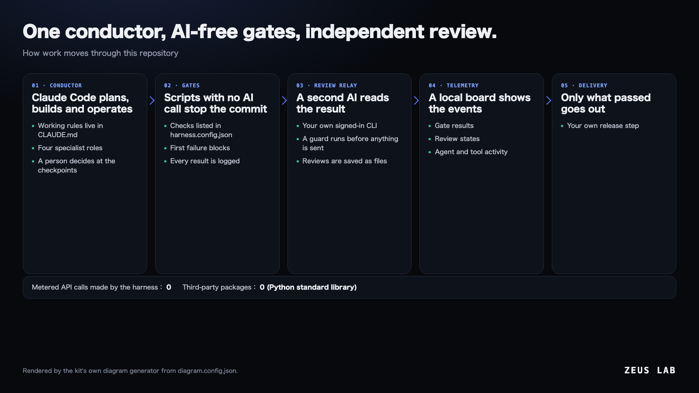

[](https://zero-trace-ship-kit.zeus-lab-global.workers.dev/hq/?utm_source=github_repo)

# zeus-harness-starter

[](https://zero-trace-ship-kit.zeus-lab-global.workers.dev/badge/?utm_source=readme_badge)

A small, free starting point for running work through Claude Code with a rule file you can read in a minute and one hook that actually refuses something.

MIT-licensed · Python standard library only · nothing to install

**[See a live board running with sample data](https://zero-trace-ship-kit.zeus-lab-global.workers.dev/harness/?utm_source=github_repo)** | **[Our own board, measured check results](https://zero-trace-ship-kit.zeus-lab-global.workers.dev/telemetry/?utm_source=github_repo)** | **[The full kit ($149)](https://zeuslab.gumroad.com/l/zeus-autonomous-harness-telemetry-kit)**



## What is here

| File | What it is |
|---|---|
| `CLAUDE.md` | A slim rule file: who you write for, five rules, how work moves |
| `hooks/guard_min.py` | One `PreToolUse` hook that refuses a commit command which skips the commit checks |
| `docs/claude-settings.example.json` | The hook entry that wires it into Claude Code. Copy it to `.claude/settings.json` in your repository (or merge it into the one you have) |
| `docs/events.sample.jsonl` | The event format a telemetry board can read: kind, name, state, duration — never tool inputs or outputs |
| `docs/diagram.png` | The wiring, as a picture |

## Try it

```sh
git clone https://github.com/ZEUSLABZERO/zeus-harness-starter.git
cp -R zeus-harness-starter/hooks your-repo/
mkdir -p your-repo/.claude && cp zeus-harness-starter/docs/claude-settings.example.json your-repo/.claude/settings.json
```

Open `your-repo` in Claude Code. When the agent tries a commit that skips the checks, the hook exits with code 2 and the agent is told to fix the cause instead.

## What this is not

The hook is a text match on the command. It does not follow what a script does once it runs, and other ways around a check are not matched: a seat belt, not a sandbox. This starter has no roles, no relay to a second AI, no board and no installer.

Those are in the paid **ZEUS LAB Autonomous Harness & Telemetry Kit** ($149, one-time): four parallel roles and a detached auditor, a guard with configurable rules, a stop report, a cross-AI audit relay, a local live board, a diagram generator and an installer with tests. It promises no results; a passing check is not a guarantee.

## License

MIT (see `LICENSE`). The paid kit is a separate product under its own license. © 2026 ZEUS LAB

---

**日本語の要約：** Claude Code で作業するための、無料の小さな出発点です。1分で読める決まりのファイル（`CLAUDE.md`）と、検査を飛ばす commit のコマンドを実行前に断るフック1本が入っています。フックは文字列の一致で見る歯止めで、隔離環境ではありません。役割・別のAIへの受け渡し・稼働盤・導入スクリプトは、有料のキット（$149）にあります。

## How much does a long thread re-send?

A free in-browser calculator shows how the input of a long Claude Code thread grows with the square of its round trips, and what a slim `CLAUDE.md`, hooks and split threads change: https://zero-trace-ship-kit.zeus-lab-global.workers.dev/cost-guard/?utm_source=github_repo
